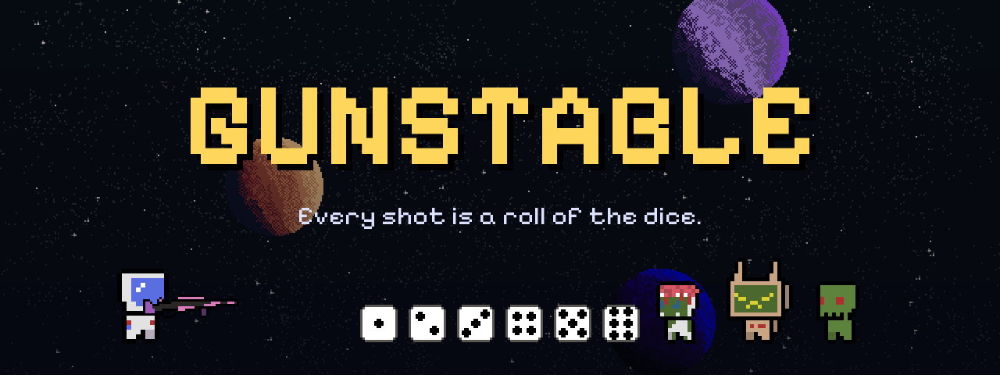
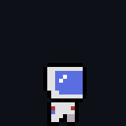
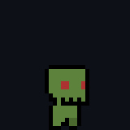
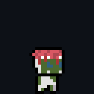
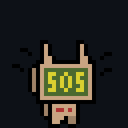
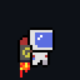
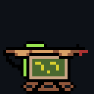

<div align="center">



<br>

**A 2D pixel-art action platformer where your gun can't be trusted.**
<br>
Blast through robots with a weapon that picks its own ammo, and fly a jetpack powered by luck.

<br>

[](https://unity.com/)
[](https://learn.microsoft.com/dotnet/csharp/)
[](https://docs.unity3d.com/Packages/com.unity.render-pipelines.universal@latest)
[](https://github.com/ygokdogan/Gunstable/releases)

[**⬇️ Download**](https://github.com/ygokdogan/Gunstable/releases/latest) · [**🎮 How to Play**](#-how-to-play) · [**🎲 Mechanics**](#-the-dice-decide) · [**🛠️ Build from Source**](#%EF%B8%8F-build-from-source)

</div>

---

## 🎲 The Dice Decide

In **Gunstable**, nothing is guaranteed. Every time you pull the trigger, the gun rolls for which bullet comes out.

| Roll | Bullet | Chance | What happens |
|:---:|:---|:---:|:---|
| 🔫 | **Default** | 45% | A clean, straight shot. Enjoy it while it lasts. |
| 💥 | **Pump** | 20% | A 5-pellet shotgun spread across 20°. |
| 🚀 | **Recoil** | 20% | Fires, then launches *you* backwards. Use it to reach new places or fly straight into danger. |
| 🚫 | **Jammed** | 15% | *Click.* Nothing. Hope you weren't counting on that one. |

### The Lucky Jetpack


Partway through the game you find a **jetpack**. While you fly, a die rolls above your head every fraction of a second. **Roll a 1 and the engine cuts out**, and you fall until you touch the ground again. Plan your flights, or trust your luck.

---

## 🤖 Meet the Cast

<table>
  <tr>
    <td align="center" width="25%"><br><b>You</b></td>
    <td align="center" width="25%"><br><b>Bomber</b></td>
    <td align="center" width="25%"><br><b>Gunner</b></td>
    <td align="center" width="25%"><br><b>Hacker</b></td>
  </tr>
  <tr>
    <td valign="top">A space explorer with 2 hit points and a very unreliable gun.</td>
    <td valign="top">Spots you, charges, then <b>jumps and explodes</b>. Keep your distance.</td>
    <td valign="top">Shoots from range and <b>flees</b> when you get too close.</td>
    <td valign="top">Harmless on its own, but get near and it <b>hacks your jetpack</b> offline. It runs away when scared.</td>
  </tr>
  <tr>
    <td align="center"><br><b>You + Jetpack</b></td>
    <td align="center"><br><b>Boom</b></td>
    <td align="center"><br><b>Turret</b></td>
    <td align="center">⏱️<br><b>The Clock</b></td>
  </tr>
  <tr>
    <td valign="top">Hold jump to fly. Watch the die.</td>
    <td valign="top">What happens when a Bomber reaches you.</td>
    <td valign="top">Fires 3-shot bursts on a timer. <b>Can't be destroyed</b>, so dodge it.</td>
    <td valign="top">A speedrun timer runs the whole game. Beat your best time on the end screen.</td>
  </tr>
</table>

---

## 🎮 How to Play

| Action | Input |
|:---|:---|
| Move | <kbd>A</kbd> / <kbd>D</kbd> |
| Jump / Jetpack | <kbd>Space</kbd> or <kbd>W</kbd> (hold to fly) |
| Aim | Mouse |
| Shoot | <kbd>Left Click</kbd> |
| Interact | <kbd>E</kbd> |
| Back to menu | <kbd>Esc</kbd> |

Get through **6 levels**, from the first steps to the jetpack unlock to the final room, as fast as you can.

### ⬇️ Download

Grab the latest build for **Windows** or **macOS** from the [**Releases**](https://github.com/ygokdogan/Gunstable/releases/latest) page, unzip it, and run.

> **macOS:** if Gatekeeper blocks the app, right-click it and choose **Open**.

---

## 🛠️ Build from Source

**Requirements:** [Unity **6000.2.8f1**](https://unity.com/releases/editor/archive) (Unity 6) with the 2D packages

```bash
git clone https://github.com/ygokdogan/Gunstable.git
```

1. Open the folder in **Unity Hub** → *Add project from disk*.
2. Open `Assets/Scenes/MainMenu.unity` and press **Play**.
3. To build: **File → Build Profiles**, choose your platform, then **Build**.

### Project Structure

```
Assets/
├── Scenes/        MainMenu → Level1 → Level2 → JetpackUnlock → Level3–5 → EndMenu
├── Scripts/
│   ├── Player/      Movement, jetpack dice, combat & bullet randomizer
│   ├── Enemies/     EnemyBase + Bomber, Gunner, Hacker, Turret state machines
│   ├── Managers/    GameManager (singleton, speedrun timer), Audio, End menu
│   ├── Input/       New Input System bindings
│   ├── Interfaces/  IDamageable, IInteractable
│   └── Utilities/   Bullets, doors, camera shake, flash effect, UI
├── Prefabs/  Sprites/  Animator/  Sounds/
```

### Built With

- **Unity 6** + **Universal Render Pipeline (2D)**
- **Unity Input System**
- **Cinemachine** for camera confiners and screen shake
- **TextMesh Pro** with the *Pixelify Sans* font

---

<div align="center">

Made with ☕ and questionable RNG by [**Yusuf Emir Gökdoğan**](https://github.com/ygokdogan)

⭐ If you enjoyed it, a star helps a lot!

</div>
